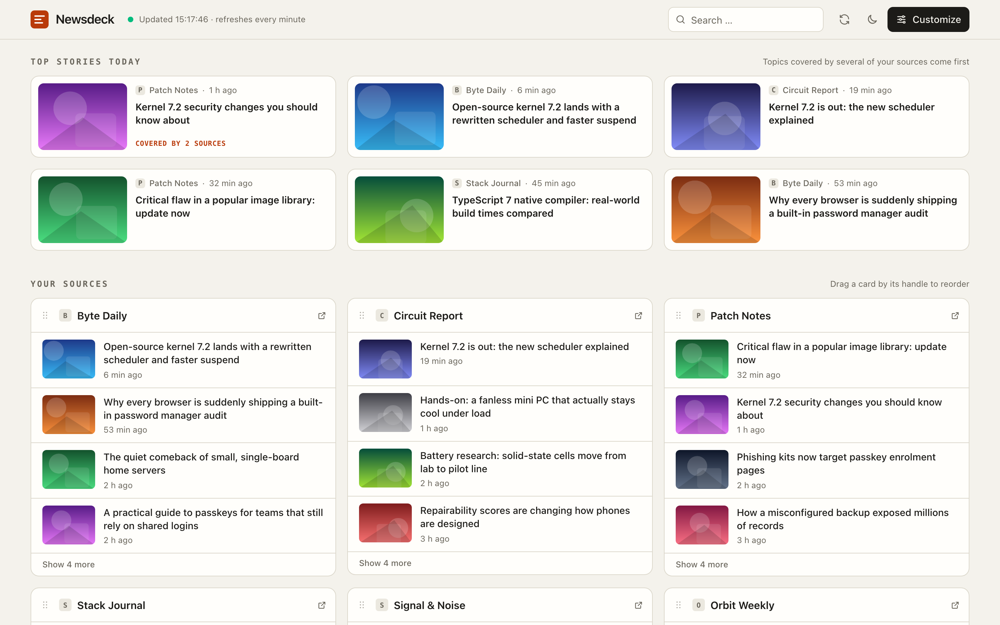
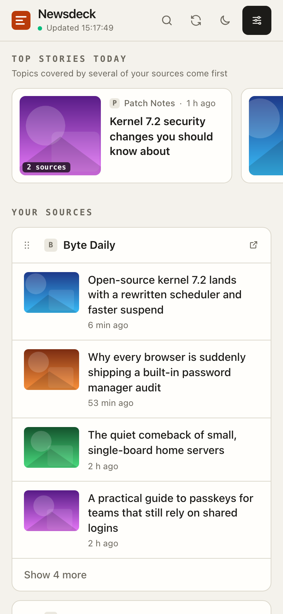

# Newsdeck

**A self-hosted tech news dashboard.** Pick your own RSS and Atom feeds, read them in one place on desktop or phone, refreshed every minute. No account, no database, no tracking. Deploys for free to Cloudflare Workers in one click.

[](https://deploy.workers.cloudflare.com/?url=https://github.com/ae3ch/newsdeck)
[](LICENSE)

<picture>
  <source media="(prefers-color-scheme: dark)" srcset=".github/screenshots/desktop-dark.png">
  
</picture>

<p align="center">
  <picture>
    <source media="(prefers-color-scheme: dark)" srcset=".github/screenshots/mobile-dark.png">
    
  </picture>
</p>

<sub>Screenshots use invented sources and headlines.</sub>

## Features

- **Your sources, your order.** A catalogue of 78 tech news sites in English and German across 13 topics (security, development, AI, Apple, Android, Linux, hardware and more), plus any site you add yourself. The feed is detected from a plain website address.
- **Top stories of the day.** Headlines that several of your sources cover are grouped and ranked first.
- **Built for phones.** Responsive layout, swipeable top stories, topic filter, large tap targets, safe-area support for notches.
- **Add to home screen.** Installable as a web app on Android, iOS and desktop. A generated link carries your layout, so the home-screen icon opens with exactly your sources, including custom ones.
- **Works offline.** The app shell is cached by a service worker; without a connection you still see the last loaded headlines.
- **Read markers.** Opened articles are dimmed, also inside the home-screen app.
- **Light and dark theme**, search across all headlines, drag and drop to reorder cards, four articles per card with "show more".
- **Private by design.** Your layout lives in your browser's local storage. Move it to another device with a file or a link; nothing is stored on the server.
- **Light on data.** Feeds are fetched once per minute for all open tabs, only changed feeds are transferred, preview images are resized and only loaded for visible articles.

## Deploy your own

### One click

1. Click **Deploy to Cloudflare** above and sign in to Cloudflare (a free account is enough).
2. Cloudflare copies this repository into your GitHub or GitLab account, builds it and deploys it as a Worker.
3. Open the `*.workers.dev` address shown at the end. Every push to your copy deploys again automatically.

Optionally add a custom domain under **Workers & Pages → your Worker → Settings → Domains & Routes**.

### From the command line

```sh
git clone https://github.com/ae3ch/newsdeck.git
cd newsdeck
npm install
npx wrangler login
npm run deploy
```

Requires Node.js 22.12 or later.

### Before you make it public

The site includes a privacy policy, a cookie policy and terms of service. Fill in `operator`, `contactEmail` and `jurisdiction` in [`src/data/site.ts`](src/data/site.ts) so these pages name you as the operator; until then they use generic wording. Review the texts for your jurisdiction.

### Cost and limits

Newsdeck runs on the Cloudflare Workers free plan:

- Static files (the page, scripts, icons) are free and unlimited.
- Only requests to `/api/*` count as Worker requests: the free plan allows 100,000 per day. One browser that stays open all day with up to 24 sources uses about 1,440 for feeds, plus a few preview image lookups, no matter how many tabs are open.
- One request loads at most 24 feeds; more sources are split across several requests.
- Feeds and preview image lookups are cached with the Cache API. Cloudflare documents it for Workers on custom domains; on a `*.workers.dev` address caching may not apply, in which case feeds are simply fetched more often.

## How it works

```
Browser (static React app)
  └─ every 60 s: GET /api/feeds?u=<feed>&u=…        (paused while the tab is hidden)
        └─ Worker: per feed, 60 s edge cache → otherwise fetch, parse, return JSON
```

| Path | Purpose |
| --- | --- |
| `src/` | The React app (Vite, Tailwind CSS). Layout and settings in `src/lib/config.ts`. |
| `worker/index.ts` | Worker entry: routes `/api/*`; everything else is served from `dist/` by Cloudflare. |
| `worker/api/feeds.ts` | Fetches and normalizes RSS 2.0, RSS 1.0 and Atom feeds. |
| `worker/api/discover.ts` | Finds the feed behind a website address. |
| `worker/api/og.ts` | Looks up the preview image (`og:image`) for articles whose feed has none. |
| `worker/_lib/safeFetch.ts` | Allows only public http(s) addresses, with time and size limits. |
| `src/sw.js` | Service worker for offline start, generated into the build with its file list. |
| `src/data/defaultSources.ts` | Topic list and source catalogue. |

### Third-party services

The browser loads preview images through the image service [wsrv.nl](https://wsrv.nl) as small WebP files and site icons from DuckDuckGo's icon service. Both see the image address and the visitor's IP address. Set `VITE_IMAGE_PROXY=off` at build time to load original images instead, or point it to a compatible service you run yourself.

## Customize

- **Sources and topics:** edit `src/data/defaultSources.ts`. Each source belongs to one topic; `starter: true` marks the sources active on a new dashboard. Keep a source's `id` stable, because saved layouts refer to it.
- **Legal pages:** `src/data/site.ts` and `src/components/legal/`.
- **Colors:** CSS variables at the top of `src/index.css`.
- **App icons:** `scripts/make-icons.sh` regenerates `public/icons/` from `public/favicon.svg` (needs `rsvg-convert`).

## Development

```sh
npm install
npm run dev        # Vite on :5173, the Worker via wrangler on :8788 (proxied as /api)
npm test           # unit tests (feed parser, URL guard, layout, ranking)
npm run test:e2e   # browser tests at phone width (Playwright, no network needed)
npm run typecheck
npm run preview    # production build served by wrangler on :8788
```

Browser tests need Chromium once: `npx playwright install chromium --only-shell`.

## License

[MIT](LICENSE). Headlines, excerpts and images shown by a running instance come from the publishers' feeds and websites and remain the property of their owners.
